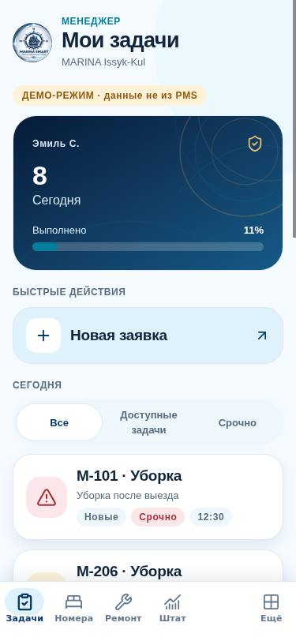
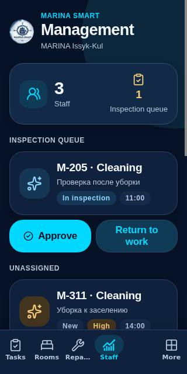
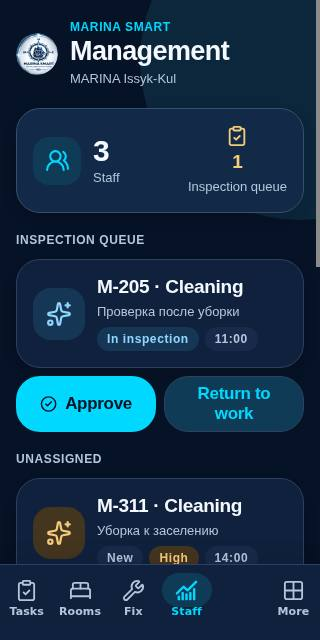
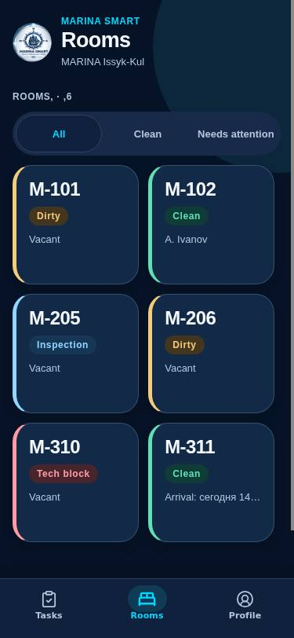
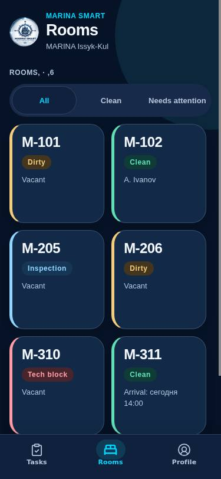
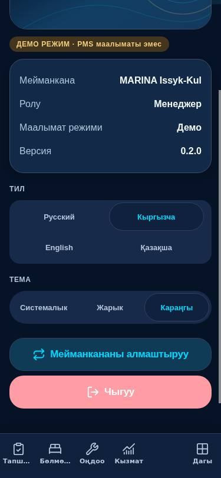
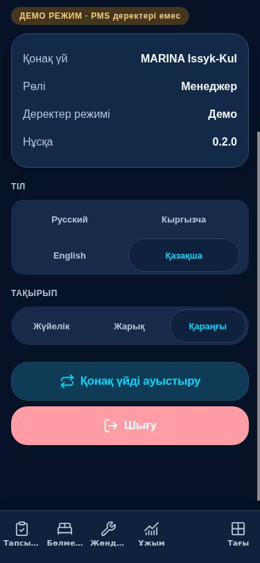
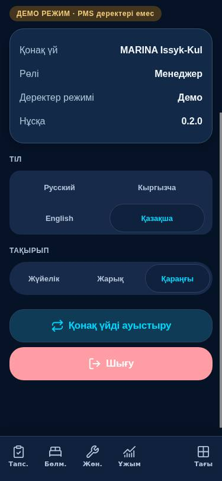

# MARINA SMART MOBILE · FUTURE LUXURY V3 — visual QA acceptance matrix

**Scope:** `apps/mobile` only · Draft PR #342. The matrix contains **22 named routes**, rather than 21.

## Evidence basis and strict distinctions

The genuine screenshots below were captured from the **running Expo Web export** in headless Google Chrome, with a built-in **DEMO-only fixture** at localhost. They are **NOT Android**, not generated illustrations and not substituted for native visual evidence. The screen source was `1b55a5a48a4ca5c616d4b0d8aa179591882d82ef`, GitHub Actions [run 41875555127](https://github.com/stvelikiy-star/resort-os/actions/runs/41875555127), mobile-check job 126734622122. The screenshot assets and this report only add documentation, not executable UI changes.

**Expo Web route QA:** 0 PASS / 0 FAIL / **11 PARTIAL** / **11 NOT TESTED**.
**Android native visual QA:** 0 PASS / 0 FAIL / 0 PARTIAL / **22 NOT TESTED**.
**Screenshots:** 21 authentic Expo Web JPEGs, at 320 / 375 / 430 viewport widths, RU / KG / EN / KZ and light / dark where noted.

**PARTIAL** means a screen was really rendered and captured in the safe DEMO context but the complete cross-product of viewport/font scale/locale/theme/data states/accessibility was not checked. **NOT TESTED** means the route was not actually rendered; source analysis and Jest never count as a visual PASS.

## Route-by-route status

| Route | Purpose / access | Expo Web visual | Android visual | Screenshot evidence |
| --- | --- | --- | --- | --- |
| `/connect` | Select demo/trusted hotel | PARTIAL | NOT TESTED | [Web 1](qa-evidence/connect_ru_light_375.jpg) |
| `/login` | All server-supported roles | PARTIAL | NOT TESTED | [Web 1](qa-evidence/login_en_dark_375.jpg) |
| `/scan` | Hotel QR connection | NOT TESTED | NOT TESTED | No safely accessible built-in DEMO screen |
| `/overview` | OWNER/MANAGER | NOT TESTED | NOT TESTED | No safely accessible built-in DEMO screen |
| `/reception` | RECEPTION | NOT TESTED | NOT TESTED | No safely accessible built-in DEMO screen |
| `/pms` | OWNER/MANAGER/AGENT | NOT TESTED | NOT TESTED | No safely accessible built-in DEMO screen |
| `/new-booking` | Permitted booking creator | NOT TESTED | NOT TESTED | No safely accessible built-in DEMO screen |
| `/reservation/[id]` | Permitted booking detail | NOT TESTED | NOT TESTED | No safely accessible built-in DEMO screen |
| `/holds` | OWNER/MANAGER where server supported | NOT TESTED | NOT TESTED | No safely accessible built-in DEMO screen |
| `/inbox` | Permitted OWNER/MANAGER/RECEPTION | NOT TESTED | NOT TESTED | No safely accessible built-in DEMO screen |
| `/conversation/[id]` | Permitted inbox users | NOT TESTED | NOT TESTED | No safely accessible built-in DEMO screen |
| `/ai` | Permitted OWNER/MANAGER/RECEPTION | NOT TESTED | NOT TESTED | No safely accessible built-in DEMO screen |
| `/tasks` | MAID/TECHNICIAN and other permitted staff | PARTIAL | NOT TESTED | [Web 1](qa-evidence/manager_tasks_ru_light_375_after_tab_fix.jpg) · [Web 2](qa-evidence/maid_tasks_en_dark_375.jpg) · [Web 3](qa-evidence/tech_tasks_en_dark_375.jpg) |
| `/task/[id]` | Permitted task detail | PARTIAL | NOT TESTED | [Web 1](qa-evidence/maid_housekeeping_detail_en_dark_375.jpg) |
| `/rooms` | Permitted staff | PARTIAL | NOT TESTED | [Web 1](qa-evidence/maid_rooms_en_dark_375_after_wrap_fix.jpg) |
| `/room/[id]` | Permitted staff | PARTIAL | NOT TESTED | [Web 1](qa-evidence/maid_room_detail_en_dark_375.jpg) |
| `/requests` | TECHNICIAN and permitted maintenance staff | PARTIAL | NOT TESTED | [Web 1](qa-evidence/tech_repairs_en_dark_375.jpg) |
| `/new-request` | Maintenance creator | PARTIAL | NOT TESTED | [Web 1](qa-evidence/tech_new_request_en_dark_320.jpg) · [Web 2](qa-evidence/tech_new_request_en_dark_375.jpg) |
| `/admin` | OWNER/MANAGER if authorized | PARTIAL | NOT TESTED | [Web 1](qa-evidence/manager_team_en_dark_320_after_nav_fix.jpg) · [Web 2](qa-evidence/manager_team_en_dark_375.jpg) · [Web 3](qa-evidence/manager_team_en_dark_430.jpg) |
| `/dining` | COOK/WAITER/authorized management | NOT TESTED | NOT TESTED | No safely accessible built-in DEMO screen |
| `/profile` | All authenticated staff | PARTIAL | NOT TESTED | [Web 1](qa-evidence/manager_profile_ru_light_375.jpg) · [Web 2](qa-evidence/manager_profile_ru_dark_375.jpg) · [Web 3](qa-evidence/manager_profile_kg_dark_375.jpg) · [Web 4](qa-evidence/manager_profile_kz_dark_375.jpg) · [Web 5](qa-evidence/manager_profile_en_dark_375.jpg) |
| `/more` | Roles with >4 allowed navigation tabs | PARTIAL | NOT TESTED | [Web 1](qa-evidence/manager_more_ru_light_375.jpg) |

## Confirmed UI fixes — same-condition before / after

Every comparison pairs **the same viewport, role, language, theme and DEMO data**.

| Observed defect | BEFORE: real Expo Web | AFTER: real Expo Web |
| --- | --- | --- |
| RU MANAGER 375px: clipped team tab |  |  |
| EN MANAGER 320px: clipped Repairs tab |  |  |
| EN MAID 375px: clipped arrival text |  |  |
| KG MANAGER 375px: clipped task/room tabs |  |  |
| KZ MANAGER 375px: clipped task/room/repair tabs |  |  |

## Additional screenshot coverage

MANAGER: task queue RU/light and EN/dark, team EN/dark at 320/375/430, profile RU/light+dark and KG/KZ/EN dark, More menu. MAID: tasks, room cards, room detail and housekeeping checklist EN/dark. TECHNICIAN: task queue, repair queue and new-request form EN/dark 375 and 320. Connect RU/light; login EN/dark. No business writes were performed.

[Authentic screenshot provenance](qa-evidence/PROVENANCE.json) includes the exact source SHA, GitHub Actions run, DEMO fixture and files.

## Follow-up polish — source-verified, awaiting fresh real visual evidence

| Surface | Proven code-level issue | Minimal correction | Evidence status |
| --- | --- | --- | --- |
| MARINA AI Orb (offline / read-only) | `AIOrb` passed `disabled={!onPress}` into `PressScale`, which automatically reduced its opacity to 0.5. This muted a visual status indicator that should not signify an inaccessible button. | `dimWhenDisabled={false}` on `AIOrb`; no new action or API capability. | SOURCE FIX; Android visual NOT TESTED, LIVE AI route Web NOT TESTED |
| OWNER/MANAGER financial KPI | At 375 dp the previous `MetricCard` forced even long values into a 46%-width column, one line, as low as 55% font scaling. Risk of unreadable KGS figures on narrow devices was confirmed by source inspection, **not** an OWNER screenshot. | Full-width card for formatted values >10 characters, <350 dp phones or >150% system font. Two-line value allowed, minimum scale now 70%. Pure layout regression tests added. | SOURCE FIX; OWNER Web/Android visual NOT TESTED |
| TECHNICIAN repair-request form at 320 px | Genuine Expo Web screenshot [before](qa-evidence/tech_new_request_en_dark_320.jpg) shows the close control moved to its own row beneath the title, consuming scarce vertical space. | Only this form opts into `PremiumHeader.inlineCompactRight`; the title can wrap while the close action stays on the same row. Other headers retain their previous behavior. | WEB BEFORE CONFIRMED; AFTER awaiting new same-condition screenshot |
| Dark profile danger button | Genuine Expo Web screenshot [before](qa-evidence/manager_profile_ru_dark_375.jpg) shows low-contrast white text on a pale pink sign-out button. Confirmed code contrast ratio **1.99:1** for `#FFFFFF` on `#FF9CA4`. | Use existing theme-aware `primaryText` on danger button, achieving calculated ratio **9.41:1** in dark mode, preserving **6.58:1** in light mode. Added a WCAG contrast regression assertion. | WEB BEFORE CONFIRMED; AFTER awaiting new same-condition screenshot |

| MANAGER assignment action | Genuine Expo Web screenshot [manager_team_en_dark_430](qa-evidence/manager_team_en_dark_430.jpg) showed a tiny `Assign` label beneath an unassigned task. Source audit verified the label was a passive `Badge`; only the task card itself opened staff selection. | Replaced passive badge with a labelled `PressScale` button, minimum 48 dp. Added a real Expo Web interaction assertion: tap `open-assign-t8`, require eligible `assign-u-maid`, then capture `manager_assign_picker_en_dark_430`. This does not submit a staff write. | WEB BEFORE + SOURCE CONFIRMED; AFTER awaits same-SHA CI screenshot |

This polish does not expand permissions, seed fake platform metrics or modify any backend API. The previously captured 21 Expo Web screenshots predate these two changes and do not evidence their final appearance; their route statuses above remain unchanged.

## Explicitly unverified or blocked

- **Android visual QA remains NOT TESTED for all 22 routes.** This review container has no Android SDK, ADB or emulator; the available GitHub workflow only builds and signs the APK. An APK build PASS is **not** a native UI PASS.
- OWNER LIVE overview, RECEPTION LIVE operations, PMS grid, booking/hold editing, WhatsApp and AI states, Dining, and QR camera were not opened with a safe authenticated server-backed fixture. No fake API responses or hotel data were injected.
- Android font scaling 150/200%, keyboard overlays, native modals, accessibility TalkBack, reduced-motion animations and safe area variants require actual-device tests.
- Some pre-existing DEMO task titles and notes are written in Russian even when the app UI is EN/KG/KZ. These are raw seed **data fields**, not app chrome; they were not silently translated.
- Full brand master comparison remains **PENDING BRAND APPROVAL**. Existing MARINA SMART original mobile raster/logo/icons were not changed.
- Backend dependencies remain unchanged: shared-auth preview 503 for Inbox/Dining/AI, no WhatsApp outbound API, AI read-only, no verified historical chart data and HOLD endpoint still blocked by existing feature checks.

**Status:** WEB VISUAL PARTIAL, ANDROID VISUAL NOT TESTED. PR remains Draft and must not be merged as an approved Android UI release without real native screenshots and manual role acceptance.
