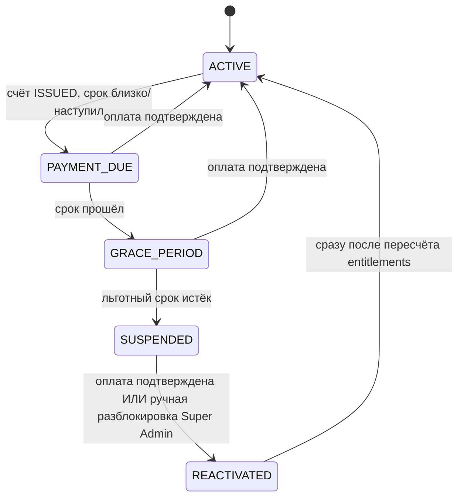

# MARINA SMART FLEX 2.0 — жизненный цикл подписки и блокировка

> **Сверка с Codex (22.11.2026):** в реализации статусы `PAYMENT_DUE`/`GRACE`; восстановление — событие `REACTIVATE_PAID`. См. `FLEX_RECONCILIATION_CODEX.md`.

Только проект. Реальных блокировок не запускать.

## 1. Автомат состояний оплаты

Параллельные атрибуты (не состояния оплаты): `TRIAL`, `GRANDFATHERED`, `CANCELLED`, `SEASONAL_PAUSE`.

## 2. Конфигурация (решает владелец)
`dueDays`, `graceDays`, порядок блокировки, исключения. Значения по умолчанию в документах **не задаются**.

## 3. Лестница блокировки (от мягкого к жёсткому)
1. **PAYMENT_DUE**: баннеры владельцу, ничего не блокируется.
2. **GRACE_PERIOD**: предупреждения всем ролям отеля, доступ полный.
3. **SUSPENDED, шаг 1 — платные функции → READ_ONLY**: история видна, новые операции запрещены. Первыми отключаются функции с наименьшим влиянием (аналитика, маркетинг, ИИ), затем остальные платные.
4. **SUSPENDED, шаг 2 — базовые операции**: *не* блокируются полностью: уже оформленные брони, заселённые гости, открытые фолио, платежи гостей и закрытие смены продолжают работать; запрещается создание **новых** бронирований/заказов только после решения владельца.
5. Неприкосновенно всегда: вход владельца, раздел «Подписка и счета», скачивание счетов и финансовых документов, экспорт данных, журнал аудита.

## 4. Обязанности по данным
Данные, брони, платежи, документы **никогда не удаляются** при блокировке; хранение не короче законодательных сроков (уточняет юрист); экспорт доступен владельцу и в `SUSPENDED`.

## 5. Защита активных операций
Блокировка проверяет «открытые операции» (заселённые стои, незакрытые заказы кухни, незавершённые платежи гостей, брони с заездом в ближайшие N часов). Если есть — функция в `READ_ONLY` с отложенным закрытием, а не `OFF`.

## 6. Восстановление
Подтверждённая оплата → в одной транзакции: статус `REACTIVATED`, пересчёт entitlements, запись в журнал, уведомление; затем `ACTIVE`. Ручная разблокировка Super Admin: причина, срок (по умолчанию ограничен), двойной журнал.

## 7. Журнал
Каждый переход: `flex_change_log` (кто/что/когда/до/после/причина/источник: SYSTEM | PLATFORM_USER). Блокировка исполняется планировщиком **только** при `FLEX_ENFORCEMENT=ENFORCE` для этого отеля; иначе пишется «было бы».

## 8. Существующая реализация / нужно
Нет: автомата, планировщика, entitlement-слоя. Есть: `AuditLog`, права по секциям. Нужно: все перечисленное + тест «блокировка не ломает заселённую бронь».

## 9. Критерии приёмки
Переходы только по таблице; повторное выполнение планировщика безопасно; при SUSPENDED владелец оплачивает и скачивает счета; после оплаты доступ восстановлен без ручных действий; активные операции не прерваны; ни одного удаления данных.
